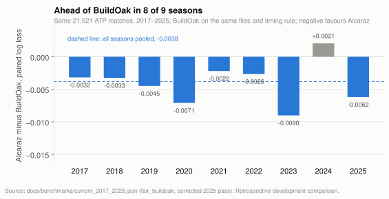

# Alcaraz

**Predicts men's tennis matches from public statistics alone. On ATP matches from 2017 to 2025 it beats every public model it has been run against, BuildOak included on the same data and timing rule, and trails the betting market by 0.0071 log loss.**

Alcaraz predicts professional tennis matches from the public record alone: results,
rankings, serve and return statistics, lower-tier history and the published draw. No
betting price, injury report or scouting note enters the model. The current version
averages two differently built models of that record. On the same data and timing rule,
Alcaraz beats BuildOak, the strongest public model that could be reproduced, over
2017–2025 (−0.0038 [−0.0056, −0.0020]). With each side's own data, by
0.0083. On earlier seasons it had never been tested on, it is ahead, within the
margin. It still trails the betting market, by 0.0071.

That market gap is the sharpest benchmark. Against Pinnacle's closing price on the same
matches, Alcaraz trails by 0.0071 log loss, down from 0.0102 for the previous version,
and picks 66.9% of winners to the market's 67.9%. The leading hypothesis is
that most of the remaining gap is information the public record does not hold: fitness,
injuries, withdrawals and how much a match matters to each player on the day.

The project was inspired by Green Code's *I Trained AI to Predict Sports*.


## Results

Log loss scores a probability forecast, and lower is better: a coin flip scores 0.693.
Every comparison below is paired, meaning both systems are scored on exactly the same
matches, with a 95% interval from a calendar-week block bootstrap (match-level for the
ladder). Every number is generated from a committed JSON built from the research result
files, and every comparison was recomputed from scratch by separate code before it was
reported. These are retrospective results: every season from 2017 to 2024 had been scored
for the previous version before the second model was built, and the second model was
developed on 2017–2021. Checks registered before their forecasts existed then covered
2024, 2015–2016 and 2025. Full tables, per-season values and the method:
[CURRENT_2017_2025_RESULTS.md](docs/benchmarks/CURRENT_2017_2025_RESULTS.md),
[RESULTS.md](docs/RESULTS.md) and [docs/benchmarks](docs/benchmarks).

### Each block of public statistics moved the model closer to the market

The same 21,361 ATP matches from 2017 to 2025, every one with a Pinnacle price. Each row
adds one block of inputs to the row above, and every step's interval excludes zero.

| Model | Log loss | Correct picks |
|---|---:|---:|
| Elo ratings only, no fitting | 0.6249 | 64.4% |
| + boosted model on results, rankings and workload | 0.6142 | 65.3% |
| + player traits and dynamic serve/return states | 0.6077 | 66.0% |
| + qualifying, Challenger and Futures history | 0.6004 | 66.4% |
| + entry status and tournament level: the previous version | 0.5993 | 66.6% |
| **Averaged with a second model: Alcaraz** | **0.5961** | **66.9%** |
| Pinnacle closing price, normalised | 0.5890 | 67.9% |

Alcaraz minus the previous version: −0.0031 [−0.0039, −0.0024], ahead in
9 of 9 seasons. Alcaraz minus Pinnacle: +0.0071 [+0.0053, +0.0089], behind
the market in each of the nine seasons; the previous version's gap was +0.0102
[+0.0082, +0.0123]. On 2025 alone the gap is +0.0072 [+0.0015, +0.0128] on 2,479
priced matches, against +0.0111 for the previous version. Both models
are refitted for each season on seasons before it and calibrated on the three seasons
immediately before it, so no season is scored by a model that has seen it.

### Head to head with public models

Each row is its own paired comparison: the public model and Alcaraz share every match in
that row, and the row's seasons are the ones the rival could be run on.

| Public model | Matches | Alcaraz minus theirs [95% interval] | Previous version minus theirs |
|---|---|---:|---:|
| [BuildOak](https://github.com/buildoak/tennis-xgboost-autoresearch) XGBoost, same files and timing rule as Alcaraz | 21,521 ATP, 2017–25 | **−0.0038 [−0.0056, −0.0020]** | −0.0006, level |
| BuildOak as released, its own data and setup | 21,521 ATP, 2017–25 | **−0.0083 [−0.0105, −0.0060]** | −0.0051 |
| [tennis-ai](https://github.com/hikmatazimzade/tennis-ai) CatBoost, refitted each season | 18,888 ATP, 2017–24 | **−0.0124 [−0.0155, −0.0092]** | −0.0094 |
| tennis-ai CatBoost given our lower-tier files | 18,888 ATP, 2017–24 | **−0.0087 [−0.0112, −0.0061]** | −0.0057 |
| tennis-ai CatBoost as shipped | 2,528 ATP, 2025 | **−0.0084 [−0.0133, −0.0035]** | −0.0046 |
| [tennis_elo](https://github.com/yaobviously/tennis_elo) ridge and LightGBM stack, look-ahead removed | 13,883 ATP, 2017–23 | **−0.0081 [−0.0104, −0.0059]** | −0.0046 |
| Five Elo and ranking baselines ([FiveThirtyEight, Kovalchik, WElo, pooled Elo, ranking logistic](docs/benchmarks/G_L_2017_2025_RESULTS.md)) | 21,521 ATP, 2017–25 | −0.0274 to −0.0376, every interval excludes zero | −0.0242 to −0.0344 |
| [Ultimate Tennis Statistics](https://github.com/mcekovic/tennis-crystal-ball) formula | 5,270 ATP, 2024–25 | −0.0280, derived (95% within about ±0.0074) | −0.0248 [−0.0309, −0.0191] |
| [Ingram's Bayesian point model](https://github.com/martiningram/tennis_bayes_point_based) | 5,270 ATP, 2024–25 | −0.0475, derived (95% within about ±0.0091) | −0.0443 [−0.0519, −0.0367] |

The first row is the fair one: BuildOak gets the same lower-tier files and the same timing
rule as Alcaraz. BuildOak as released reads main-tour files only, with its own setup, so
that row compares complete systems with different data. Ultimate Tennis Statistics and
Ingram were not rerun for the current version. On the same rows the previous version
reproduces its published log loss exactly, so Alcaraz's log loss there minus each rival's
published log loss is exact as a point estimate; the interval is a conservative bound, not
a bootstrap ([details](docs/benchmarks/CURRENT_2017_2025_RESULTS.md#ultimate-tennis-statistics-and-ingram)).



BuildOak edged Alcaraz in 2024, the season registered as the confirmation, on the fair
timing rule: +0.0021 [−0.0016, +0.0060], inside its interval. On 2014–2016,
seasons on which no forecast of either side had ever been scored, the second model alone
beats BuildOak,
−0.0029 [−0.0053, −0.0006] on 7,131 matches, and Alcaraz is ahead on 2015–2016 within the
margin, −0.0023 [−0.0051, +0.0003] on 4,806. Those are the earliest seasons the models can
reach: Challenger serve statistics begin in 2010, and the models need six warm-up seasons.

### 2025, with its bug

A pre-registered test, run with a bug we found and fixed afterwards, read level
(−0.0050 [−0.0111, +0.0008]); with the bug fixed, Alcaraz wins by
0.0062 [0.0018, 0.0110], on 2,559 matches. When the second model chose
its 2025 settings from 2022–2024, the file it read had 2024's results blanked, left over
from when 2024 was sealed, so it chose badly and its 2025 forecasts were squashed toward
50/50. No 2025 result leaked in. The independent recomputation caught the defect, and the
fix changed nothing but restoring the 2024 labels. The corrected run came after the
registered result had been seen, so it is the model's correct 2025 number, not a blind
confirmation. The 2017–2025 result against BuildOak does not depend on the fix:
−0.0037 before it, −0.0038 after.

### The timing rule, and what favours the rivals

A forecast may use a result only from two days after its match date, because historical
files give tournament weeks rather than exact days and results reach the public with a
lag. BuildOak's own setup used results at once and dated lower-tier results on the Sunday
of their week, so it saw Challenger results a few days sooner. Over 2017–2024 that setup
was worth 0.0024 [0.0010, 0.0038] to it, almost all of it from that
timing; the fair comparison puts both models on the same rule. Two findings favour the rivals and make Alcaraz's wins
conservative: tennis-ai's CatBoost reads files that list most events final-first in five
seasons, so a winner's later-round results reach his earlier rows, and BuildOak's own
setup also looks ahead on dates. BuildOak does adjust serve for the opponent.

### The previous version's other results

The current version covers the men's tour only and has not been run against every system
the previous version met. These results are the previous version's and stay on their pages:

- the women's tour, where the BuildOak comparison is inconclusive:
  [BUILDOAK_2017_2025_RESULTS.md](docs/benchmarks/BUILDOAK_2017_2025_RESULTS.md);
- IBM Match Insights on the Grand Slam forecasts that were provably issued before play:
  [IBM02_RESULTS.md](docs/benchmarks/IBM02_RESULTS.md);
- Green Code's Wimbledon 2025 men's draw:
  [REFIT2025_RESULTS.md](docs/benchmarks/REFIT2025_RESULTS.md);
- where the previous version's lead over BuildOak came from, match by match:
  [WHY01_LEAD_DECOMPOSITION.md](docs/benchmarks/WHY01_LEAD_DECOMPOSITION.md).

## What is in the model

Alcaraz averages two models built from the same public record in different ways. For
every match it takes the mean of their log-odds, with equal weights fixed before any test
and never fitted on test data.

**The previous version** is a histogram gradient-boosting classifier over 57 inputs,
refitted each season on a five-year window and calibrated on the three seasons before the
target. Its inputs come in five blocks, and the ladder above adds them one at a time:

- **Ratings.** Overall and surface Elo from tour results.
- **Match history.** Rankings, recent workload and rest, match format, player traits.
- **Serve and return states.** A dynamic model of each player's serve and return
  strength, updated match by match and adjusted for who they played. This is the block
  that separates a strong run from an easy draw.
- **Lower-tier history.** Qualifying, Challenger and Futures results and serve
  statistics. It is the largest single gain in the ladder because it fills in the years
  before a player reaches the main tour.
- **Draw context.** Each player's entry status (qualifier, lucky loser, wild card,
  protected ranking) and the tournament level, both published with the draw. Round and
  seeding are not used. This block came out of an independent review that found the model
  underrated qualifiers; it gains 0.0012 [0.0006, 0.0017] on the ladder's matches, in
  7 of 9 seasons.

**The second model** is built on an all-tier match table from 1991 (tour, qualifying,
Challenger and Futures), and it trains on tour, qualifying and Challenger matches as
examples, not only as history. Its inputs are all-tier, tour-only and surface Elo; rating
uncertainty; decayed serve and return rates; an opponent-adjusted point model turned into a
match-win probability through exact game, tiebreak and set chains; form, activity,
experience, ranking momentum, traits and head-to-head. Its strongest block is a Kalman
serve/return state: each player's serve and return strength is tracked as an estimate with
its own uncertainty, updated point by point and widening while the player is idle. Its four
settings were tuned only on 2000–2010 serve points, so no tested season influenced them. It
trains on three windows (the last 8, 12 and 16 seasons); each chooses among three tree
settings and fits a calibration slope on the three previous seasons only, and the second
model is the average of the three windows' log-odds.

**Why the average helps.** The two models are built from different data, windows and
features, so their errors are only partly shared, and averaging cancels part of each
one's errors. Over 2017–2024 the average scores 0.5945 on every target match, against
0.5947 for the second model and 0.5976 for the previous version. Its gain over the previous
version held on seasons never used to build the second model: −0.0029 on 2024,
−0.0035 on 2015–2016 and −0.0038 on 2025. In the defective 2025 run the second
model alone was worse than the previous version (+0.0057), yet the average still beat
the previous version, because half its weight sat on a model the bug did not touch.

No price, odds or market field enters either model. Every result, rating and statistic
must be knowable two days before the match date; draw facts such as surface, format, entry
status and level come with the pairing itself. The pipeline records which outcomes each
fold read and refuses anything later.

## Registered before scored, recomputed before reported

Every comparison above was registered before it was scored: the matches, the cutoff, the
inputs, the primary contrast and the pass rule were frozen and hashed first, then scored
once. Separate code recomputed every estimate and interval from the raw inputs before a
result was reported, which is why the 2024 result against BuildOak and the 2025 bug are
on record. Leak detectors enter CI only after failing a planted leak. The previous
version's 145-entry leaderboard and 133-entry experiment ledger are published in
`data/registries`, so every attempt, including the failures, is visible. Nothing here is
an untouched test set: every season through 2025 had been scored for the previous version,
so the current version's results extend the record rather than test it blind.

Independent review found each of these failures, and each one changed a rule:

| What review found | What it would have done | What changed |
|---|---|---|
| Draw-page round order was being turned into match dates | A 2026 Canada final leaked into two later Cincinnati rows | Every date now carries a typed basis: anchor, bound or clock |
| A learned constant was fitted through 2016 and used inside 2014–16 folds | Selection data influenced a "past-only" parameter | Every learned constant carries a horizon receipt |
| A calibration stage wrote scores before the report barrier | Downstream barriers could not stop an upstream scorer | Forecasts are emitted before the barrier, scores after |
| A 24-test leakage suite stayed green when leaks were planted | "All green" meant nothing | A detector enters CI only after it fails its planted control |
| The second model's 2025 settings were chosen from a file with 2024's results blanked | The registered 2025 test ran on forecasts squashed toward 50/50 | Every forecast generator asserts a valid label on every selection row |

## Experiments that did not improve the model

A null here is a result, not an abandoned idea. Every row but the first concerns the
previous version and was a registered comparison on matched matches.

| Tried | Result | Outcome |
|---|---|---|
| Tuning the previous version alone: longer windows, older rows, recency weights, bigger trees, monotone constraints, soft labels from points won, margin targets, bagging; BuildOak-style feature breadth in the second model | level in development (2017–2021) | a second, differently built model instead |
| Larger boosting head, longer training window | +0.0033 log loss, interval wholly adverse | keep the small model |
| Eight-member stack over the incumbent and alternatives | −0.0004, interval crosses zero | not adopted |
| Uncertainty-aware serve/return states through the final model | +0.0002 | not adopted |
| Serve sub-components, richer state geometry, WTA selection policy | all within ±0.0002 | not adopted |
| Market-as-teacher distillation | −0.0007 against outcome-only | below the 0.003 gate |
| Model + Pinnacle residual | worse than calibrated Pinnacle alone | market already contains the model |
| Past-only logit blend with BuildOak, ATP 2020–24 | −0.0009 [−0.0021, +0.0003] against Alcaraz alone; with 2025 added, −0.0011 with an interval that touches zero | no ATP blend released |
| One registered tuning pass over the boosted head: 110 candidates with early stopping, tree size, minimum leaf, L2 and bagging | −0.0000 [−0.0004, +0.0003] on 18,972 ATP matches | model frozen |
| Weather, fatigue, point-by-point states | worse or null | retired |

## Run it

```sh
make setup
make reproduce-small     # the previous version's pipeline on a synthetic sample
make reproduce-current   # the current version end to end on a synthetic sample
```

The first takes about a minute and the second a few; CI runs both on every push. The
codebase is 56k lines of Python in one pipeline, with 824 tests and a locked environment.

On real data the current version is four commands. The first runs the previous version
for 2017–2025; the others build the all-tier table, fit the second model and average the
two:

```sh
uv run tennislab chain run --config configs/chains/atp_refit2025_2017_2025.json
uv run tennislab current table --config configs/current/atp_table.json
uv run tennislab current fit --config configs/current/atp_alltier.json
uv run tennislab current pool --config configs/current/atp_pool.json
```

The table takes about a minute and a half, and the fit about a quarter of an hour on a
14-core machine (`TENNISLAB_ALLTIER_WORKERS` sets the workers). The per-season forecasts
land in `data/runs/current_atp/pool/current/`, and on the pinned inputs they equal the
forecasts scored above, bit for bit. Every input is read under `TENNISLAB_WORKSPACE` and
checked against its hash first. Real match history is governed by source terms and stays
out of Git: the match files are a hash-pinned snapshot of Jeff Sackmann's `tennis_atp`
repository ([DATA.md](docs/DATA.md)). The published model checkpoints are an earlier version's, in a
[GitHub release](https://github.com/riddlejack/Alcaraz/releases/tag/models-2026-09-14)
with an [inference guide](docs/MODEL_RELEASE.md); the current version is not in it.

## Scope and limits

- Retrospective research. Earlier versions have issued forecasts for two real matches
  before their scheduled start under a [hash-chained ledger](docs/live.md); no scored
  prospective record exists yet, and the current version has issued no forecast.
- The current version covers the men's tour only. Every women's-tour comparison in this
  repository is the previous version's.
- The 2025 result against BuildOak rests on the corrected run, made after the registered
  result had been seen. The 2017–2025 result holds on both runs.
- Ultimate Tennis Statistics and Ingram were not rerun for the current version. Their
  current-version rows are derived: exact as point estimates, because the previous version
  reproduces its published log loss on the same rows, with a conservative bound in place of
  a bootstrap interval.
- The current version's calibration has been checked only descriptively, on 2017–2024
  (slope 1.02, where 1 is calibrated), not in a registered test.
- Pinnacle's quote time is unknown, so the market comparison is descriptive.
- The head-to-head rows compare complete systems with different legitimate histories.
  BuildOak's recipe was selected by its author with sight of later data, so it is
  in-sample on every season here.
- The current version is research forecasts: it is not in the model release.

Methods: [METHODS.md](docs/METHODS.md) · Data and licences:
[DATA.md](docs/DATA.md), [DATA_LICENSES.md](DATA_LICENSES.md)

Code is MIT. Match, ranking and player data are from Jeff Sackmann / Tennis Abstract
under CC BY-NC-SA 4.0. The XGBoost comparison adapts
[buildoak/tennis-xgboost-autoresearch](https://github.com/buildoak/tennis-xgboost-autoresearch).
